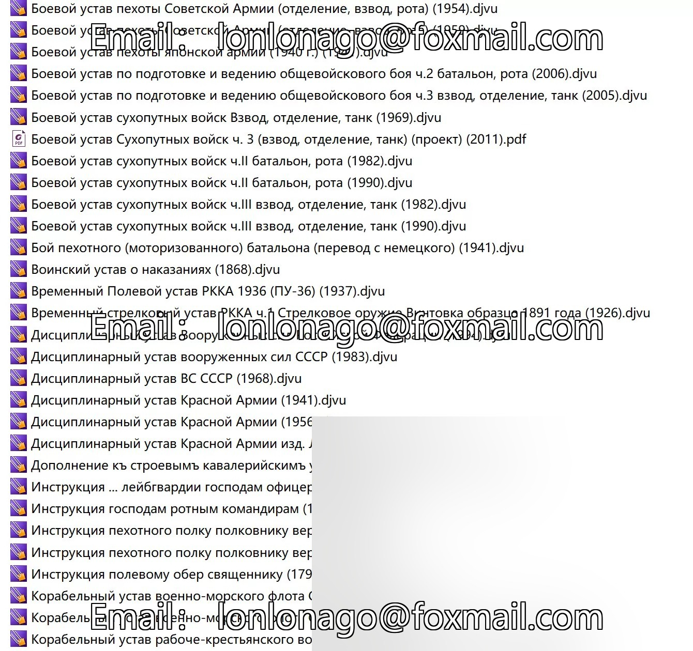
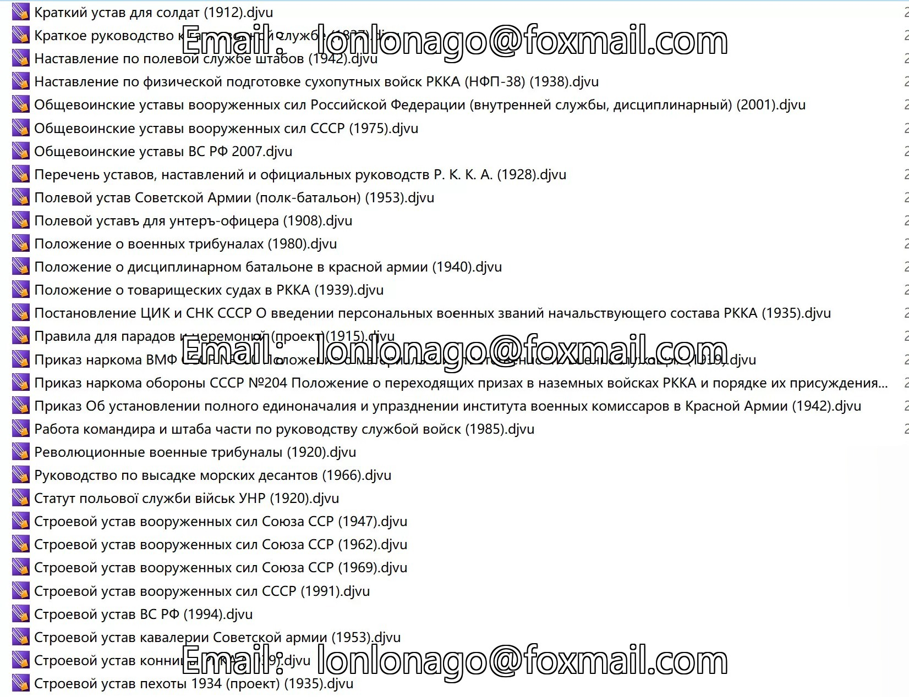
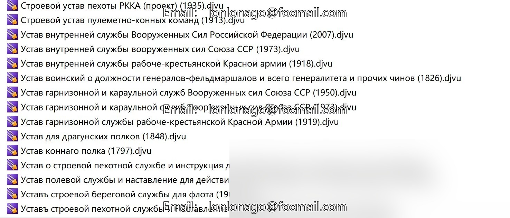

# Soviet/Russian - Military regulations and regulations literature spanning from 1764 to 2007

## Body

Soviet/ Russian Military Regulations and Rules Literature Collection spanning from 1764 to 2007.

First image file list (1954-1986)

Combat regulations of the Soviet Army Infantry (detachment, squad, platoon) (1954).
《Soviet Army Infantry Combat Regulations (commando, platoon, company level)》(1954)

Battle Regulation of the Soviet Army Infantry Corps (section, squad, battalion) (1959). (Revised version, 1959)

Japanese Army Infantry Battle Regulations (1940 edition) (1941 translation version)

Battlemanion, Division (2006).djvu
《Combined Artillery Operations Manifesto · Part 2: Brigade, Company Level》(2006 Russian Federal Edition)

Battle Command of Land Army: Platoon, Battalion, Tank (1969 Soviet version)

Battle Regulation of the Army (Volume 3) Chapter 3 (unit, formation, tank) (project) (2011).pdf
"The Army Combat Regulation · Volume 3: Platoon, Formation, Tank" (2011 draft)

War Manual on Penalties (1868).djvu
The Military Code of Sanmohr by (1868).

Disciplinary Regulations of the Armed Forces of the Russian Federation (1994).

Discipline Statute of the Soviet Armed Forces (1983). d.j.dvu
"The Military Discipline Regulations of the Soviet Armed Forces (1983)"

Instructions for the squadmaster in the infantry battalion (version 1) (1764 handwritten)

Naval and Coastal Fortification Regulations of the Soviet Union (1986). dju

Second image file list (1837-2007)

Short regulations for soldiers (1912).djvu
"The Soldier Compendium" (1912 Russian version)

Deployment in the field command staff (1942).djvu
The Field Combat Service Guide (1942 Guoqung Warfare edition)

Common War Regulations of the Armed Forces of the Russian Federation (2001). "The Common Regulations of the Armed Forces of the Russian Federation" (2001).

Field ordinance for an officer (1908). djvu
Ordnance Regulations for military personnel (1908 Russian edition)

Position on the discipline battalion in the Red Army (1940).djvu
《Red Army Penalization Battalion Regulations》 (1940)

Armed Forces Service Sheet of the Soviet Union (1991).djvu
"Orders for the Quantities and Organization of the Armed Forces of the Soviet Union" (1991 Final Edition)

Naval cadet corps service regulations of the Soviet army (1953).djvu
《Soviet Army Cavalry Corps Regulations》(1953)

Guidance on seizing seaborne landings (1966). djvu
《Naval Marines Landing Operations Guide》(1966)

Third image file list (1797-2007)

Staff of the Department of Internal Services of the Russian Armed Forces (2007).djvu
***
*Federal Order of the Russian Armed Forces on the Internal Affairs of Military Units (2007)*

1826: War Officer Position Regulation (1826 Russian Semirepublic edition).

State Armored Guard Service Guard Regulations (1919).djvu
"Red Army Guard Regulations" (1919 national war edition)

The Accord of the Cavalry Regiment (1797). djvu
The Regulations of the Cavalry Regiment (1797, during the reign of Catherine the First)

Army Military Service Operations Regulations (1897)

The subject covers military regulations and rules of the Soviet/Russian country spanning 1764-2007, with image lists detailing multiple related documents and versions.

<!-- AI_ENRICHED -->

## Images

## Payment

Here is a pay link on Stripe ( https://buy.stripe.com/3cs8yP7sY87d0vu9AB ). Please contact me lonlonago@foxmail.com after funding $89, and I will send you a complete data files , thank you!

